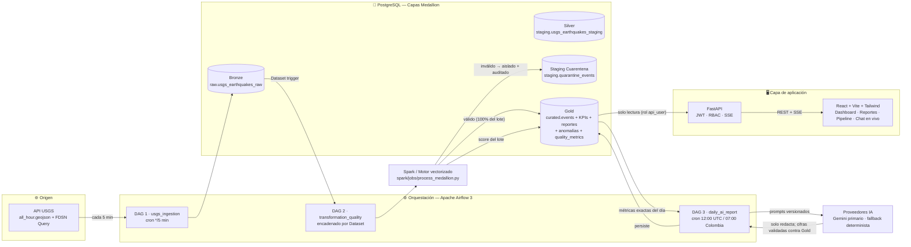
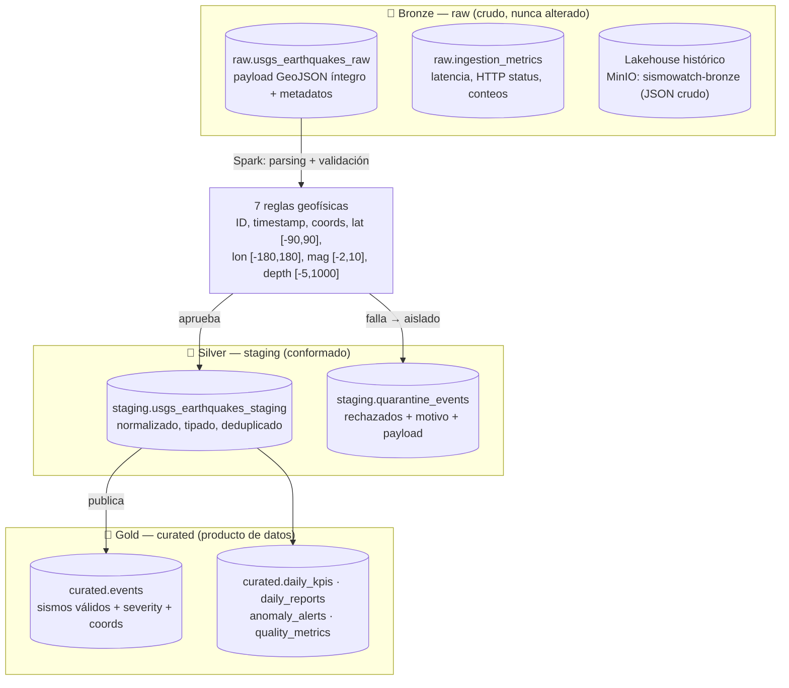
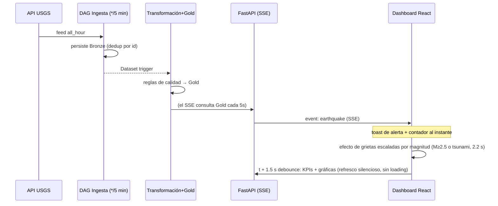
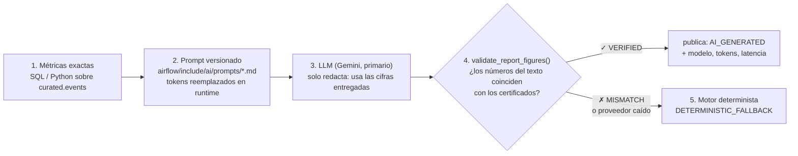
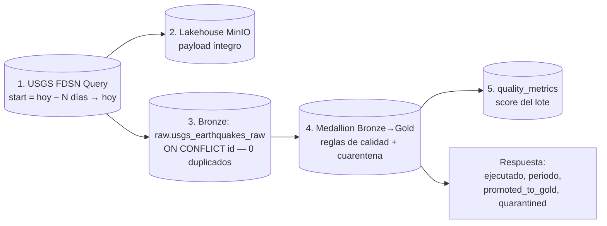

# SismoWatch — Plataforma de Monitoreo Sísmico Global

> Observatorio de datos con ingesta continua del USGS, pipeline Medallion orquestado con Apache Airflow,
> calidad de datos con cuarentena, IA generativa con anti-alucinación verificada, detección de anomalías
> estadísticas y radio en tiempo real vía SSE — todo dockerizado y con control de acceso por roles.

---

## 1. ¿Qué es?

SismoWatch convierte los feeds públicos del **USGS (United States Geological Survey)** en un
**producto de datos certificado y consumible**:

| Capacidad | Cómo lo hace |
|---|---|
| Monitoreo en vivo | Notificaciones SSE y actualización silenciosa de KPIs/gráficas sin recargar la página (~2.4 s de punta a punta) |
| Histórico estructurado | Arquitectura Medallion (Bronze → Silver → Gold) sobre PostgreSQL con idempotencia garantizada |
| Calidad auditada | 7 reglas geofísicas por lote, cuarentena trazable y score de calidad expuesto en la UI |
| IA confiable | Reportes ejecutivos y chat con cifras **calculadas en SQL** y validadas contra alucinaciones |
| Anomalías | Detector Z-Score para enjambres sísmicos y picos de magnitud M≥6.0 |
| Historia masiva | Backfill paramétrico idempotente de 1 a 60 días (botón admin o CLI; default 30) |
| Catálogo de datos | OpenMetadata 2.0.7 incluido en el mismo `docker compose up -d`: descubre, documenta y perfila las tablas del Medallion con acceso solo-lectura |

---

## 2. Arquitectura general



**Decisiones clave detrás del diseño:**

| Decisión | Por qué |
|---|---|
| Apache Airflow como orquestador | Reintientos, cron de ingesta, encadenamiento por `Dataset` (ingesta dispara transformación) y trazabilidad de ejecuciones expuesta también vía REST API v2 en la pantalla de Pipeline |
| PostgreSQL Medallion (no Spark distribuido) | Volumen real del dominio (miles de sismos/día) cabe en una BD relacional; Spark/PySpark local vectorizado prepara el salto a clúster gestionado (EMR/Dataproc) si el histórico escala |
| SSE en vez de WebSockets | El monitoreo es unidireccional servidor→cliente; reconexión nativa del navegador, sin handshake ni overhead de sockets |
| El LLM **solo redacta**, nunca calcula | Toda cifra se computa en SQL/Python; si el texto del LLM no coincide con los números certificados, el reporte se descarta y lo reemplaza un motor determinista (anti-alucinación con evidencia auditable) |
| Roles de BD con mínimo privilegio | `ingest_user` escribe solo Bronze; `transform_user` solo Silver/Gold; `api_user` solo lectura de Gold |

---

## 3. Arquitectura Medallion en detalle



**Idempotencia end-to-end:** Bronze inserta con `ON CONFLICT (id) DO UPDATE` y Gold con
`ON CONFLICT (event_id) DO UPDATE` condicionado a `updated_time` — re-ejecutar un pipeline o
un backfill **nunca duplica registros** (hay prueba unitaria de idempotencia en
`spark/tests/test_spark_transformer.py`). En re-publicaciones de USGS, Gold conserva el
`published_at` original: un evento actualizado no "renace" ni re-entra al stream en vivo.

**Invariante innegociable:** ningún registro inválido llega jamás a Gold. Si un lote completo
sale inválido, la calidad se marca `BLOCKED`, se detiene la publicación y se dispara el
`failure_alert_callback` de Airflow.

---

## 4. Flujo en tiempo real (notificaciones y refresco en vivo)



- El stream `GET /api/stream` solo emite eventos **genuinamente nuevos** (fresco: `published_at`
  desde la conexión **y** `event_time ≥ NOW() - 70 min`): el histórico del backfill nunca entra al canal.
- **Dos relojes distintos en el dashboard:** la tabla se ordena por `event_time` (cuándo *ocurrió*,
  UTC, estándar científico) y la tarjeta "Última Actualización" muestra `MAX(published_at)`
  (cuándo *entró a Gold*, hora Colombia, latido del pipeline). Un evento puede haber ocurrido
  antes de que USGS lo entregue — ambos cambios son correctos midiendo cosas distintas.
- Alternativa de sonido opcional ante sismos de severidad crítica o advertencias de tsunami.

---

## 5. IA generativa con control anti-alucinación



- **Prompts versionados en el repositorio** (`airflow/include/ai/prompts/`, con plantillas
  sistema/usuario del reporte y del chat): cualquier cambio de prompt es auditable por git.
- **Ruta de chat (`POST /api/chat`)**: clasifica la intención, consulta Gold con parámetros,
  inyecta los datos certificados al prompt y responde con las cifras citadas; el frontend
  siempre pasa por el backend (la key de IA se expone solo dentro de la red Docker).
- Registro completo de cada generación en `curated.daily_reports`: `generation_status`,
  tokens y latencia — el detalle de qué se generó y con qué garantías es auditable.

---

## 6. Pantallas y funcionalidad

| Pantalla | Contenido |
|---|---|
| **Dashboard** | 6 tarjetas KPI (incl. Puntaje de Calidad y Última Actualización), mapa epicentral interactivo (Leaflet + escala por severidad), actividad por hora/día (eje real según ventana), distribución por magnitud y top regiones — todo refresca en vivo |
| **Registro de sismos** | Tabla paginada completa (sin filtros de magnitud), ordenada por hora de ocurrencia; los eventos en vivo se anteponen en la página 1 |
| **Reportes** | Historial de reportes diarios, vista del reporte con métricas y cifras certificadas, regeneración admin, exportación CSV/HTML |
| **Pipeline & Calidad** | Bronze/Silver/Gold con contadores reales, estado de cada DAG consultado en vivo contra la REST API v2 de Airflow (con degradación controlada a evidencia de BD), y backfill paramétrico para admins |
| **Chat en vivo (widget flotante)** | Asistente analítico con respuestas fundamentadas solo en datos certificados: estadísticas de sismos, rankings y comparativas en tablas, explicación de la propia plataforma y guardia conversacional que rechaza consultas ajenas sin exponer texto a ningún proveedor IA |

---

## 7. Puesta en marcha

### 7.1 Requisitos
- Docker Engine 24+ y Docker Compose v2.
- **8 GB RAM disponibles** (Airflow + PostgreSQL pesan ~4 GB; OpenMetadata añade
  MySQL + Elasticsearch + JVM, ~4–6 GB más).
- **Compatible con Windows, Linux y macOS:** el compose usa rutas relativas y volúmenes
  nombrados; no hay dependencias del sistema anfitrión más allá de Docker. Para detener:
  `docker compose down` (los datos persisten en los volúmenes).

### 7.2 Inicialización

```bash
# 1. Configura tu entorno: crea .env a partir de la plantilla y agrega tu GEMINI_API_KEY
cp .env.example .env
#    → obtén la key en https://aistudio.google.com/apikey (solo se usa dentro de la red Docker)

# 2. Levanta todo
docker compose up -d

# 3. Verifica
docker compose ps
```

> El primer arranque genera automáticamente esquemas, roles y usuarios semilla
> (`db/init/*.sql`) y los DAGs empiezan a correr por su cuenta. Para poblar el histórico
> con datos certificados inmediatamente, entra como Admin y ejecuta el backfill (sección 8):
> ```bash
> curl -X POST http://localhost:8000/api/admin/backfill -H "Authorization: Bearer <jwt_admin>" -H "Content-Type: application/json" -d '{"days": 30, "min_magnitude": 2.5}'
> ```

### 7.3 URLs y accesos

| Servicio | URL | Credenciales |
|---|---|---|
| **SismoWatch Web** | [http://localhost:3001](http://localhost:3001) | ver sección 8 |
| **API FastAPI (Swagger)** | [http://localhost:8000/docs](http://localhost:8000/docs) | — |
| **Airflow UI** | [http://localhost:8088](http://localhost:8088) | `admin` / `admin_sismowatch` |
| **MinIO Console** (lakehouse Bronze) | [http://localhost:9001](http://localhost:9001) | `sismowatch_minio_admin` / `sismowatch_minio_pass_2026` |
| **PostgreSQL** | `localhost:5434` | `sismowatch_admin` / `sismowatch_db_pass_2026` |
| **OpenMetadata** (sección 7.5) | [http://localhost:8585](http://localhost:8585) | `admin@open-metadata.org` / `admin` (cambiar tras el primer login) |

Todas las credenciales anteriores viven en `.env` (plantilla: `.env.example`); los valores
mostrados son los defaults de la plantilla de demostración.

### 7.4 Usuarios de demostración

| Rol | Correo | Contraseña | Alcance |
|---|---|---|---|
| **Admin** | `admin@sismowatch.internal` | `AdminSecure2026!*` | Todo: backfill histórico, regeneración IA, cuarentena, exportación oficial |
| **Viewer** | `viewer@sismowatch.internal` | `ViewerSecure2026!*` | Dashboard, mapa, stream en vivo, reportes y lectura; los endpoints admin responden **HTTP 403** (verificado por pruebas) |

El RBAC no depende de la UI: el backend valida el JWT y el rol en **cada** invocación.

### 7.5 Catálogo de metadatos: OpenMetadata

El proyecto integra **OpenMetadata 2.0.7** como catálogo de datos: descubre y documenta
las tablas del Medallion (`curated.events`, `staging.*`, `raw.*`), su linaje, glosario,
propietarios y las métricas de calidad del pipeline perfiladas como tests de datos.

**Arranca junto a todo** con el mismo `docker compose up -d` de la sección 7.2. Su diseño
de integración protege el flujo existente:

| Mecanismo | Efecto |
|---|---|
| Stack completamente aislado | OpenMetadata trae su **propio** MySQL y Elasticsearch (volúmenes nombrados propios); no comparte BD, esquemas ni red lógica de datos con el Medallion |
| Sin dependencias cruzadas | Ningún servicio de SismoWatch depende de OpenMetadata: los contenedores base no tocan ni esperan al catálogo |
| Solo lectura vía conector | El descubrimiento se hace con el conector PostgreSQL usando `api_user` (mínimo privilegio, solo lectura de Gold): el conector nunca escribe ni modifica datos de negocio |
| Degradación controlada | Si el stack de metadatos se detiene, Airflow/Spark/API/Web siguen operando 100%: el catálogo es un complemento observacional, no un eslabón del pipeline |

**Acceso:**

```bash
docker compose up -d        # arranca TODO: SismoWatch + catálogo

# Catálogo OpenMetadata http://localhost:8585 → admin@open-metadata.org / admin
```

> El catálogo no descubre nada por sí solo al arrancar: hay que registrar el servicio
> PostgreSQL y lanzar su primer workflow de ingesta (pasos abajo), que se ejecuta en el
> contenedor de ingesta `openmetadata_ingestion` incluido en el mismo compose.
>
> En el primer arranque, el contenedor `openmetadata_migrate` ejecuta la migración inicial
> de la BD del catálogo (tarda ~1–2 min; sale con código 0 al terminar). Para detener todo:
> `docker compose stop` (los volúmenes persisten).

**Primer uso — registrar el Medallion (valores exactos):**

En la UI (*Databases → Add New Service → PostgreSQL*):

| Campo | Valor | Nota |
|---|---|---|
| Service Name | `sismowatch_medallion` | el nombre que quieras; este UI lo referencia después |
| Connection Type | PostgreSQL | — |
| Host and Port | `postgres:5432` | host es el nombre del servicio Compose, no `localhost` |
| Database | `sismowatch_db` | |
| Auth Configuration | **Basic Auth** | (ignora las opciones IAM/Azure del panel derecho) |
| Username | `api_user` | rol mínimo-privilegio de solo lectura (vive en `.env`) |
| Password | `api_secret_2026` | (vive en `.env`) |
| Test Connection | debe responder *successful* | si falla, revisa host/credenciales |

En la pantalla de ingesta de metadatos: nombre `sismowatch_medallion_metadata`,
activa **Include Sample Data** y **Include Lineage**, luego **Deploy** y después **Run**.

1. Cuando el workflow termine en **Success**, las tablas de `raw`, `staging` y `curated`
   aparecerán catalogadas (columnas, tipos, conteos y muestra), con el grafo de linaje
   en la pestaña **Lineage**.
2. La ingesta se agenda diaria; refresca conteos y esquema en cada corrida.
3. **Sample Data:** los defaults de fábrica de los agentes de AutoPilot bloquean la
   muestra (distinguen solo tablas Tier1/Tier2 y vienen con `storeSampleData` apagado).
   Una vez registrado el servicio, corre:

   ```bash
   python scripts/om_first_run.py
   ```

   Corrige filtros, dispara los agentes y verifica que `curated.events` quede con su
   muestra (hasta 50 filas). Es idempotente: puedes re-correrlo cuando quieras
   (`--service`, `--url`, `--user/--password` permiten personalizar).
4. Opcional: registra el servicio **S3** apuntando al bucket `sismowatch-bronze` de MinIO
   (`minio:9000`, credenciales `MINIO_ROOT_*` del `.env`) para catalogar el lakehouse, y el
   servicio **Airflow** en `http://airflow:8080` (`admin` / `admin_sismowatch`) para ver
   los DAGs de ingesta del proyecto.

**Credenciales de demostración:** `admin@open-metadata.org / admin` — cambiarlas en
`Settings → Users` tras el primer login si el entorno se comparte. Todas las variables
OpenMetadata están en `.env.example` (prefijo `OPENMETADATA_`).

---

## 8. Backfill histórico paramétrico e idempotente

**Qué hace:** llena el histórico de Gold. Recibe `days` (días hacia atrás) y `min_magnitude`
y ejecuta el flujo completo en una sola corrida auditable:



**Por qué "idempotente":** si se ejecuta dos veces con los mismos días, el resultado es
idéntico — cada evento se identifica por el `event_id` del USGS (único por definición) y
Bronze/Gold usan upserts (`ON CONFLICT … DO NOTHING/UPDATE`). El dato ya cargado no se
replica; un **rerun** solo revalida y respeta `updated_time` (así, volver a correr un backfill
cuando hay un error no genera registros dobles ni "revive" el histórico como nuevo).
Los sismos históricos cargados por backfill **no entran al stream en vivo** (ventana de
frescura del SSE): solo pintan gráficas y la tabla histórica.

> Requiere rol admin: devuelve **403** para viewers.

---

## 9. Calidad de datos y cuarentena

Reglas evaluadas por lote (implementadas en `airflow/include/quality/quality_checker.py`,
sin alguna valor física):

1. **ID obligatorio** — el id del USGS debe existir y no ser vacío (dedup global)
2. **Timestamp válido** — epoch positivo y coherente
3. **Coordenadas obligatorias** — `[lon, lat, depth]` numéricos
4. **Latitud** en `[-90, 90]`
5. **Longitud** en `[-180, 180]`
6. **Magnitud** en `[-2.0, 10.0]` (el USGS registra microsismos negativos en equipos de alta sensibilidad)
7. **Profundidad** en `[-5, 1000]` km (los negativos = eventos en edificios volcánicos o canteras)

Cada rechazo se audita en `staging.quarantine_events` con reglas fallidas, `execution_id`
y payload íntegro original — la acción de cuarentena siempre es revisable, ni un evento se
descarta silenciosamente.

---

## 10. Detección de anomalías (Z-Score)

- Ventana móvil de frecuencia por región en `curated.events`.
- **Enjambre sísmico:** Z-Score > 2.5 con concentración espacial y temporal.
- **Pico de magnitud:** eventos M ≥ 6.0.
- Cada alerta queda en `curated.anomaly_alerts` con la advertencia explícita: una anomalía
  estadística **no** es una alerta de terremotos.

---

## 11. Seguridad — evidencia real y reproducible

```bash
# 1) Escaneo estático (Bandit, umbral Medium+): resultado objetivo actual → 0 Medium / 0 High
python -m bandit -r api airflow spark -ll

# 2) Vulnerabilidades conocidas de dependencias: → "No known vulnerabilities found"
python -m pip_audit -r requirements.txt
```

- **Secretos:** ninguna credencial en el código; todo pasa por `.env` (el `.gitignore` protege el
  archivo que contiene la key de IA).
- **BD mínimo privilegio:** esquemas y roles creados por `db/init/01_init_schemas_roles.sql`
  (`ingest_user`, `transform_user`, `api_user`).
- **RBAC real:** JWT firmado (HS256, secret en `.env`), expiración 120 min y verificación
  de rol servidor en cada endpoint administrativo.

---

## 12. Pruebas automatizadas

```bash
python -m pytest airflow/tests api/tests spark/tests
```

```text
airflow\tests\test_dag_integrity.py .s                      # . = pasó, s = DagBag requiere contenedor Airflow
airflow\tests\test_prompting_and_figures.py ......          # prompts versionados + validador anti-alucinación
api\tests\test_auth.py ...                                  # hashing bcrypt, flujo JWT, 401
api\tests\test_chat_routing.py ..............................................  # intents, ventanas temporales, guardia conversacional, tablas certificadas
api\tests\test_endpoints.py ...                             # health, 403 viewer en admin/endpoints, fallback determinista
spark\tests\test_spark_transformer.py ....                  # transformación, cuarentena, quality, idempotencia

67 passed, 1 skipped
```

Dentro del contenedor oficial de Airflow 3 (`apache/airflow:3.3.2`) la carga nativa de DAGs
verifica: `3 DAGs encontrados, 0 errores de importación`.

---

## 13. Estructura del repositorio

```text
├── docker-compose.yml           # PostgreSQL + MinIO + Airflow + API + Web + OpenMetadata 2.0.7 (catálogo)
├── .env.example                 # Plantilla de entorno (la key de IA va vacía)
├── requirements.txt             # Deps de pruebas/desarrollo (pytest, bandit, pip-audit…)
├── docs/
│   └── ARQUITECTURA.md          # Especificación técnica extendida
├── db/init/                     # DDL + roles mínimo-privilegio + seed users (bcrypt)
├── airflow/
│   ├── dags/                    # 3 DAGs: ingesta */5, transformación por Dataset, reporte diario 07:00 Col
│   ├── include/
│   │   ├── ingestion/           # cliente USGS + backfill paramétrico
│   │   ├── quality/             # 7 reglas + cuarentena + score
│   │   ├── analytics/           # detector Z-Score
│   │   ├── ai/                  # cliente IA, prompts versionados/ y validador de cifras
│   │   ├── db.py, config.py     # conexión por rol y configuración central
│   │   └── storage/             # persistencia MinIO lakehouse
│   └── tests/
├── spark/
│   ├── jobs/process_medallion.py  # medallion core + idempotencia (ON CONFLICT)
│   └── tests/
├── api/
│   ├── app/routers/             # auth, kpis, events, stats, reports, quality, stream (SSE), admin, anomalies
│   ├── app/services/            # sse_manager.py (stream en vivo), chat_service.py, exportador
│   ├── app/auth/                # JWT + require_role
│   └── tests/
└── web/
    ├── src/pages/               # LoginPage, DashboardPage, ReportsPage, PipelineQualityPage, ChatAIPage
    ├── src/components/          # LiveToastNotification, ScreenCrackEffect, EarthquakeMap, FloatingChatWidget, ChatMarkdown…
    ├── src/services/            # api.ts (cliente tipado), sse.ts (reconexión automática)
    └── src/context/AuthContext.tsx
```

---

## 14. Guía rápida de demostración

1. **Prueba de roles:** entre con Viewer → pestaña Pipeline (cuarentena restringida visible) → cierre sesión → entre con Admin (aparecen backfill y cuarentena).
2. **En vivo:** permanezca en el Dashboard con el stream conectado; cuando llegue el próximo sismo M≥2.5 o tsunami, verá la toast, el efecto de grietas y las estadísticas reflejando el evento en segundos, sin recargar la página.
3. **IA:** en el widget flotante de chat pregunte (ej. "¿Cuántos sismos hubo en las últimas 24 horas?"), pida una comparativa ("ranking de las regiones con mayor actividad" — responde con tabla), o pregunte por la plataforma ("¿cómo funciona la arquitectura medallion?"). Una consulta ajena ("¿quién ganó el partido?") es rechazada sin exponer el texto a ningún proveedor IA. En Reportes, el Admin puede regenerar el informe (día UTC cerrado, validado anti-alucinación).
4. **Backfill:** en Pipeline & Calidad, ejecute el backfill paramétrico de N días y compruebe que los contadores de Bronze/Silver/Gold crecen sin duplicar (vuelva a ejecutarlo: mismos números).
5. **Auditabilidad:** en Pipeline & Calidad, los estados de DAG se consultan en vivo de la REST API de Airflow (SUCCESS/PASSED con tiempos reales).

---

## 15. Limitaciones y camino a producción

1. **Spark clúster dedicado:** hoy PySpark vectorizado en contenedor; a escala de TB → EMR/Dataproc.
2. **Notificaciones push corporativas:** el `failure_alert_callback` está listo; producción lo conectaría a Slack/PagerDuty/Telegram (webhook configurable vía `ALERT_WEBHOOK_URL`).
3. **Búsquedas semánticas geológicas:** `pgvector` sobre comentarios históricos de USGS.
4. **Alta disponibilidad:** Airflow standalone hoy; producción usaría executor Celery/Kubernetes con réplicas de api-server.
5. **Catálogo de metadatos en producción:** hoy OpenMetadata convive con el stack en Compose (sección 7.5); en producción se alojaría en BD gestionada (RDS MySQL) y OpenSearch gestionado, con inyección programática de los DAGs Airflow como servicio de pipeline.
