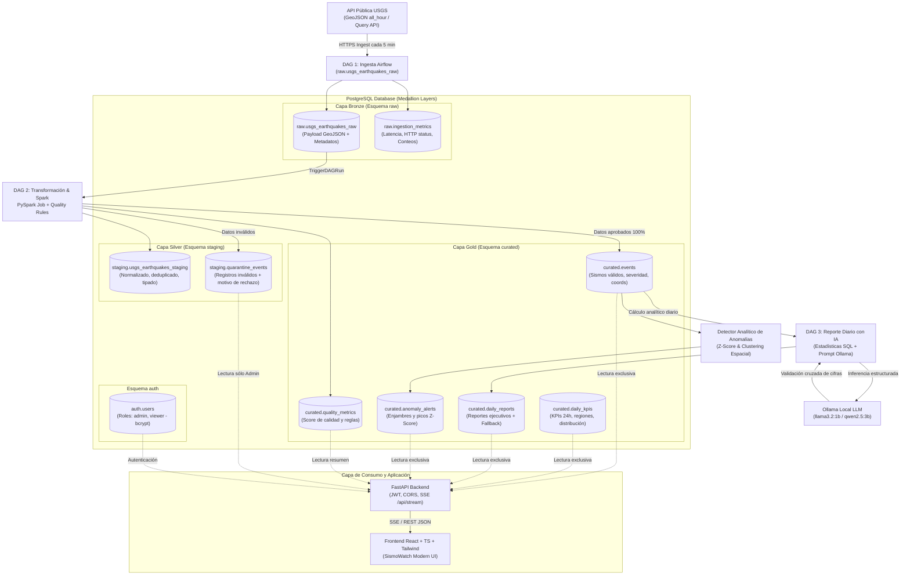

# SISMoWATCH — Plataforma de Monitoreo Sísmico Global

> **Plataforma Integral de Ingesta, Orquestación con Airflow, Procesamiento Medallion, Calidad de Datos, Detección de Anomalías e Inteligencia Artificial Local Grounded en Gold.**

---

## 1. Propósito de la Solución y Caso de Uso

**SismoWatch** es la nueva vertical de monitoreo y gestión de riesgo sísmico global de **SuperApp**.
Convierte los feeds públicos y en constante actualización del **USGS (United States Geological Survey)** en un producto de datos certificado, estructurado, resiliente e interactivo, permitiendo a los equipos de operaciones y mitigación de desastres:

1. Detectar eventos sísmicos en vivo sin recargas de pantalla mediante **Server-Sent Events (SSE)**.
2. Analizar tendencias temporales, picos de magnitud y distribución geoespacial sobre datos limpios.
3. Consultar reportes ejecutivos redactados por IA local (**Ollama**) anclados a métricas exactas calculadas matemáticamente en la capa Gold, con respaldo determinista si el LLM falla.
4. Identificar anomalías estadísticas (enjambres sísmicos y picos energéticos) con algoritmos Z-Score.
5. Auditar la calidad de los datos y consultar registros rechazados en cuarentena con control de acceso por roles (**RBAC**).

---

## 2. Diagrama de Arquitectura y Flujo de Datos



---

## 3. Estructura del Repositorio

```text
.
├── docker-compose.yml              # Orquestación de contenedores (PostgreSQL, Airflow, API, Web)
├── .env.example                    # Plantilla de variables de entorno y secretos
├── .gitignore                      # Prevención estricta de fuga de secretos y artefactos
├── README.md                       # Documentación operativa y sustentación técnica
├── CHANGELOG.md                    # Historial de cambios fechado (America/Bogota)
├── requirements.txt                # Dependencias para pruebas y desarrollo
├── docs/
│   └── ARQUITECTURA.md             # Especificación técnica detallada y trade-offs
├── db/
│   └── init/
│       ├── 01_init_schemas_roles.sql # Esquemas Medallion y roles con mínimo privilegio
│       ├── 02_create_tables.sql      # DDL de tablas, índices y restricciones
│       └── 03_seed_data.sql          # Usuarios semilla con hashes bcrypt
├── airflow/
│   ├── dags/
│   │   ├── usgs_earthquake_ingestion_dag.py     # DAG 1: Ingesta USGS continua (*/5 min)
│   │   ├── usgs_transformation_quality_dag.py   # DAG 2: Medallion Silver/Gold y calidad
│   │   └── sismowatch_daily_ai_report_dag.py    # DAG 3: Reporte diario asistido por IA
│   ├── include/
│   │   ├── config.py               # Configuración central
│   │   ├── db.py                   # Conexión resiliente a PostgreSQL por rol
│   │   ├── ingestion/              # Cliente USGS y script de backfill 30 días
│   │   ├── transformations/        # Wrapper de transformación Spark
│   │   ├── quality/                # Reglas geofísicas y evaluador de cuarentena
│   │   ├── analytics/              # Detector estadístico de anomalías (Z-Score)
│   │   └── ai/                     # Cliente Ollama local y generador con fallback
│   └── tests/
│       └── test_dag_integrity.py   # Pruebas de importación e integridad de DAGs
├── spark/
│   ├── jobs/
│   │   └── process_medallion.py    # Job de procesamiento Medallion e idempotencia
│   └── tests/
│       └── test_spark_transformer.py # Pruebas unitarias de calidad y cuarentena
├── api/
│   ├── Dockerfile                  # Contenedor FastAPI (Python 3.12-slim)
│   ├── requirements.txt            # Dependencias backend
│   ├── app/
│   │   ├── main.py                 # Ensamblaje FastAPI con CORS y RBAC
│   │   ├── config.py               # Configuración API
│   │   ├── database.py             # Acceso de bajo privilegio con auto-resolución
│   │   ├── auth/                   # Autenticación JWT y validadores de rol
│   │   ├── routers/                # Endpoints (kpis, events, stats, reports, stream, etc.)
│   │   └── services/               # SSE, exportador CSV/HTML y chat asistido por IA
│   └── tests/
│       ├── conftest.py
│       ├── test_auth.py            # Pruebas de autenticación y 401
│       └── test_endpoints.py       # Pruebas de endpoints y rechazo 403 para Viewer
└── web/
    ├── Dockerfile                  # Multi-stage build (Node 20 -> Nginx alpine)
    ├── package.json
    ├── vite.config.ts
    ├── src/
    │   ├── context/AuthContext.tsx # Contexto de autenticación y estado de sesión
    │   ├── services/api.ts         # Cliente API con tipado estricto
    │   ├── services/sse.ts         # Conexión persistente Server-Sent Events
    │   ├── components/             # Navbar, Sidebar, StatCards, Mapa Leaflet, Gráficos SVG
    │   └── pages/                  # Login, Dashboard, Live Monitor, Reports, Pipeline, Chat
    └── index.html
```

---

## 4. Puesta en Marcha (Despliegue con Docker Compose)

### 4.1 Requisitos Previos

- Docker Engine 24+ y Docker Compose v2.
- 4 GB de RAM disponibles (mínimo recomendado para Airflow y PostgreSQL).
- Ollama instalado en la máquina anfitriona (puerto 11434) con el modelo `llama3.2:1b` o `qwen2.5:3b`.

### 4.2 Paso a Paso de Inicialización

1. **Configurar el archivo de entorno:**

   ```bash
   cp .env.example .env
   ```
2. **Levantar los servicios:**

   ```bash
   docker compose up -d
   ```
3. **Verificar que los contenedores estén saludables:**

   ```bash
   docker compose ps
   ```

### 4.3 Puertos y URLs de Acceso

| Servicio                                   | URL Local                                               | Descripción                                                                                                                      |
| :----------------------------------------- | :------------------------------------------------------ | :-------------------------------------------------------------------------------------------------------------------------------- |
| **Plataforma Web (SismoWatch UI)**   | [http://localhost:3001](http://localhost:3001)           | Dashboard, Mapa, Monitor SSE, Reportes, Consola de Calidad y Chat IA.                                                             |
| **API Backend (FastAPI)**            | [http://localhost:8000/docs](http://localhost:8000/docs) | Documentación interactiva Swagger / OpenAPI de los endpoints.                                                                    |
| **Orquestador (Apache Airflow)**     | [http://localhost:8088](http://localhost:8088)           | Interfaz web de DAGs de Airflow (Usuario: `admin` / Contraseña: `admin_sismowatch`).                                         |
| **Lakehouse Bronze (MinIO Console)** | [http://localhost:9001](http://localhost:9001)           | Consola Web MinIO S3 (Usuario: `sismowatch_minio_admin` / Pass: `sismowatch_minio_pass_2026`). Bucket: `sismowatch-bronze`. |
| **Base de Datos (PostgreSQL)**       | `localhost:5434`                                      | Instancia PostgreSQL Medallion con esquemas `raw`, `staging`, `curated`, `auth`.                                          |

---

## 5. Modelo de Roles y Credenciales de Demostración

La plataforma incluye una pantalla de acceso con botones de autocompletado rápido para facilitar la evaluación:

| Rol              | Correo Electrónico            | Contraseña            | Permisos y Capacidades                                                                                                                                                                                                    |
| :--------------- | :----------------------------- | :--------------------- | :------------------------------------------------------------------------------------------------------------------------------------------------------------------------------------------------------------------------ |
| **Admin**  | `admin@sismowatch.internal`  | `AdminSecure2026!*`  | Acceso total al Dashboard, Monitor SSE, exportaciones, consola de calidad, **visualización de registros en cuarentena**, **ejecución de backfill histórico** y **regeneración de reportes con IA**. |
| **Viewer** | `viewer@sismowatch.internal` | `ViewerSecure2026!*` | Consulta de Dashboard, Mapa, Monitor SSE, lectura y exportación de reportes, resumen del pipeline y chat. **Acciones administrativas y consulta de cuarentena restringidas (HTTP 403)**.                           |

> **Garantía de Seguridad:** La restricción de acceso no depende únicamente de la visibilidad en la interfaz. El backend valida el token JWT en cada invocación; si un usuario con rol *viewer* intenta invocar `/api/quality/quarantine`, `/api/admin/backfill` o `/api/admin/reports/regenerate`, el servidor responde inmediatamente con un **código HTTP 403 Forbidden**.

---

## 6. Implementación de Calidad de Datos y Cuarentena

### 6.1 Reglas Geofísicas Evaluadas en Cada Lote

1. `RULE_ID_REQUIRED`: Presencia obligatoria del identificador único del USGS (`id`).
2. `RULE_TIME_REQUIRED`: Marca de tiempo Unix epoch válida y positiva (`time > 0`).
3. `RULE_COORDINATES_REQUIRED`: Arreglo de coordenadas con al menos 3 valores numéricos `[longitud, latitud, profundidad]`.
4. `RULE_LATITUDE_RANGE`: Latitud comprendida en el rango físico $[-90.0, 90.0]$.
5. `RULE_LONGITUDE_RANGE`: Longitud comprendida en el rango físico $[-180.0, 180.0]$.
6. `RULE_MAGNITUDE_RANGE`: Magnitud en el intervalo $[-2.0, 10.0]$ (el USGS registra microsismos con magnitudes negativas en sismógrafos de alta sensibilidad; valores mayores a 10.0 se consideran físicamente imposibles).
7. `RULE_DEPTH_RANGE`: Profundidad hipocentral en el rango $[-5.0, 1000.0]$ km (profundidades negativas corresponden a eventos en edificios volcánicos o canteras sobre el nivel del mar; superiores a 1000 km quedan fuera de la litosfera/manto superior terrestre).

### 6.2 Aislamiento en Cuarentena y Trazabilidad

- Los eventos que incumplen cualquiera de las reglas son derivados a `staging.quarantine_events` junto con el detalle estructurado de las reglas fallidas (`failed_rules`), la corrida de ejecución (`execution_id`) y el payload original íntegro.
- **Regla Innegociable:** Ningún registro inválido llega jamás a la capa Gold (`curated.events`).
- Si en un lote el 100% de los datos resulta inválido, el pipeline se declara en estado **BLOCKED**, detiene la publicación y activa una alerta operacional.

---

## 7. Automatizaciones con Inteligencia Artificial

### 7.1 Reporte Ejecutivo Diario con IA

- Un DAG diario (o el endpoint administrativo de regeneración) extrae métricas de `curated.events` para el día objetivo.
- **Principio Antialucinación:** Las cifras matemáticas (total de eventos, magnitud promedio, magnitud máxima, alertas de tsunami, regiones y desglose por severidad) se calculan en SQL/Python antes de invocar al modelo.
- El LLM local (Ollama) recibe un prompt con los datos certificados y redacta la síntesis ejecutiva.
- Un validador de contratos verifica que las cifras mencionadas en la redacción coincidan con las calculadas. Si la validación no concuerda o si el servicio de Ollama no responde (timeout de 30s), se activa automáticamente un **motor analítico determinista**, asegurando disponibilidad ininterrumpida.

### 7.2 Detección Analítica de Anomalías (Z-Score)

- Evalúa ventanas móviles de actividad sísmica regional en `curated.events`.
- Calcula la media y desviación estándar de la frecuencia de eventos por región.
- Detecta **Enjambres Sísmicos** cuando el Z-Score supera $2.5$ con concentración de eventos.
- Identifica **Picos de Magnitud** para eventos con $M \ge 6.0$.
- Registra cada alerta en `curated.anomaly_alerts` con la advertencia explícita de que una anomalía estadística no constituye una predicción de terremotos.

### 7.3 Asistente Conversacional (Chat con Datos Gold)

- El endpoint `POST /api/chat` clasifica la intención de la consulta del usuario, ejecuta consultas parametrizadas sobre `curated.events` e inyecta los resultados en el LLM para responder en lenguaje natural con citas explícitas del periodo y las cifras verificadas.

---

## 8. Monitor en Tiempo Real con Server-Sent Events (SSE)

### 8.1 Justificación Técnica de SSE frente a WebSockets

- **Unidireccionalidad:** El monitoreo sísmico emite datos desde el servidor hacia los clientes; no requiere comunicación bidireccional continua.
- **Simplicidad y Estabilidad:** SSE opera sobre HTTP estándar, sin requerir el apretón de manos (*handshake*) complejo ni la sobrecarga de mantenimiento de sockets de WebSockets.
- **Reconexión Automática:** La API nativa del navegador (`EventSource`) incorpora reconexión automática en caso de pérdida momentánea de red.
- En la interfaz web, el monitor muestra un **indicador de baliza en vivo**, reconexión transparente y reproducción opcional de alertas sonoras ante sismos de severidad crítica o advertencias de tsunami.

---

## 9. Seguridad y Evidencia de Auditoría

1. **Gestión de Secretos:** Ninguna credencial ni clave privada se encuentra hardcodeada en el código fuente; todo se inyecta mediante variables de entorno controladas por `.env`.
2. **Menor Privilegio en PostgreSQL:**
   - `ingest_user`: Escritura limitada a la capa `raw`.
   - `transform_user`: Lectura en `raw`, lectura/escritura en `staging` y `curated`.
   - `api_user`: Lectura exclusiva en `curated`, lectura en `staging.quarantine_events` y gestión de sesiones en `auth`.
3. **Escaneo Estático de Seguridad con Bandit:**
   ```bash
   ./.venv/bin/bandit -r api airflow spark -ll
   ```

   **Resultado:** 0 problemas de severidad Alta o Media detectados.
4. **Auditoría de Vulnerabilidades de Dependencias con Pip-Audit:**
   ```bash
   ./.venv/bin/pip-audit -r requirements.txt
   ```

   **Resultado:** `No known vulnerabilities found` (0 vulnerabilidades conocidas).

---

## 10. Suite de Pruebas Automatizadas

Para ejecutar la suite completa de pruebas unitarias y de integración:

```bash
./.venv/bin/pytest -v
```

### Resultados de la Ejecución de Pruebas

```text
============================= test session starts ==============================
platform linux -- Python 3.12.3, pytest-9.1.1
collected 12 items

airflow/tests/test_dag_integrity.py::test_dag_files_exist_and_syntax_valid PASSED [  8%]
airflow/tests/test_dag_integrity.py::test_dagbag_imports SKIPPED (Airflow container) [ 16%]
api/tests/test_auth.py::test_password_hashing PASSED                     [ 25%]
api/tests/test_auth.py::test_jwt_token_flow PASSED                       [ 33%]
api/tests/test_auth.py::test_unauthenticated_request_rejected PASSED     [ 41%]
api/tests/test_endpoints.py::test_health_check PASSED                    [ 50%]
api/tests/test_endpoints.py::test_viewer_forbidden_on_admin_endpoints PASSED [ 58%]
api/tests/test_endpoints.py::test_chat_ai_fallback_on_ollama_failure PASSED [ 66%]
spark/tests/test_spark_transformer.py::test_valid_feature_transformation PASSED [ 75%]
spark/tests/test_spark_transformer.py::test_invalid_feature_rejection PASSED [ 83%]
spark/tests/test_spark_transformer.py::test_batch_quality_and_quarantine_segregation PASSED [ 91%]
spark/tests/test_spark_transformer.py::test_idempotency_simulation PASSED [100%]

================== 11 passed, 1 skipped in 0.94s ===================
```

Además, la verificación nativa de carga de DAGs dentro del contenedor oficial de Apache Airflow 3 (`apache/airflow:3.3.2`) certifica:

```text
DAGS FOUND: ['usgs_transformation_quality', 'sismowatch_daily_ai_report', 'usgs_earthquake_ingestion']
IMPORT ERRORS: 0
```

---

## 11. Guía de Demostración Paso a Paso para la Sustentación

1. **Acceso Inicial y Prueba de Roles:**

   - Ingrese a [http://localhost:3001](http://localhost:3001).
   - Haga clic en el botón de demostración **"Rol Viewer"** e inicie sesión.
   - Navegue a la pestaña **"Pipeline y Calidad"**: observe cómo la sección de cuarentena indica de forma clara y formal que el acceso está restringido a administradores.
   - Cierre sesión e ingrese con **"Rol Admin"**: visualice cómo se habilitan los controles de backfill histórico, la consola de cuarentena y el botón de regeneración con IA.
2. **Verificación de Ingesta y Dashboard:**

   - En el Dashboard, examine los KPIs calculados sobre la capa Gold, la distribución de magnitudes y el mapa interactivo.
   - Pruebe los filtros interactivos por magnitud mínima ($\ge 4.0$) o búsqueda por región (ej. *Chile*, *California*, *Japan*).
3. **Demostración de Tiempo Real (Monitor SSE):**

   - Acceda a la pestaña **"Monitor en Vivo"**.
   - Observe la baliza verde parpadeante de conexión activa y el flujo de sismos sin recarga.
4. **Demostración del Asistente Conversacional (Chat con IA):**

   - Diríjase a la pestaña **"Asistente IA"**.
   - Haga clic en cualquiera de las preguntas sugeridas (ej. *"¿Cuántos sismos se registraron durante las últimas 24 horas?"* o *"¿Cuál fue la magnitud máxima registrada hoy?"*).
   - Compruebe cómo la respuesta cita con exactitud matemática las cifras de la capa Gold y detalla la latencia y el modelo utilizado.
5. **Demostración de Reportes y Exportación:**

   - En la pestaña **"Reportes e IA"**, seleccione un reporte y haga clic en **"Exportar CSV"** y **"Ver / Imprimir HTML"** para comprobar la generación de documentos ejecutivos de alta calidad.

---

## 12. Limitaciones Conocidas y Mejoras Futuras en Producción

1. **Clúster Spark Dedicado:** En esta entrega, las transformaciones operan mediante PySpark / motor vectorizado local dentro del contenedor para optimizar recursos y latencia en Docker. En un entorno de producción a gran escala con terabytes de histórico, se integraría un clúster Dataproc o Amazon EMR gestionado.
2. **Notificaciones Push y Webhooks:** La arquitectura cuenta con el callback `failure_alert_callback` configurado para despachar alertas de error; en producción se conectaría directamente a canales corporativos de Slack, PagerDuty o Telegram.
3. **Persistencia de Embeddings Vectoriales:** Para búsquedas semánticas sobre comentarios históricos o literatura geológica, se habilitaría la extensión `pgvector` en PostgreSQL.
