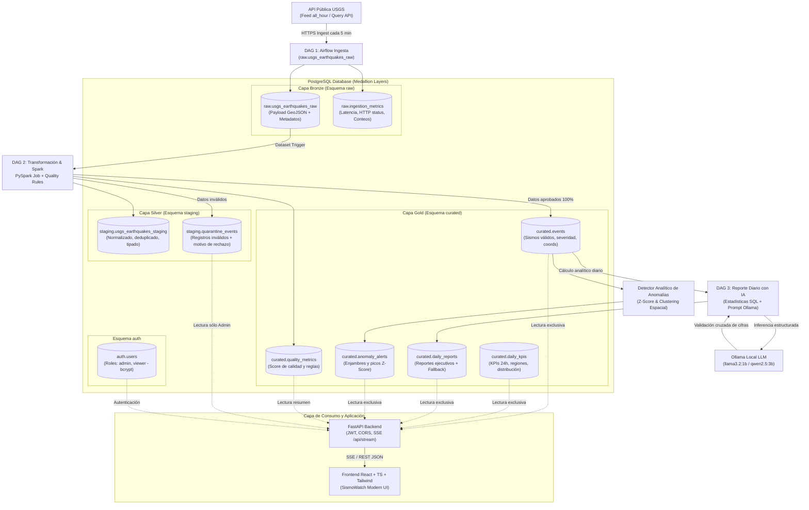

# Documento de Arquitectura y Diseño Técnico — SismoWatch

## 1. Propósito de la Solución y Caso de Uso

### 1.1 Problema que resuelve
Las áreas de Operaciones, Gestión del Riesgo y Continuidad del Negocio de **SuperApp** requieren visibilidad inmediata sobre la actividad sísmica global para priorizar protocolos de emergencia, evaluar impacto en infraestructura crítica y anticipar alertas de tsunami. 
Históricamente, la información residía exclusivamente en un feed público del USGS (United States Geological Survey) que se actualiza minuto a minuto, sin persistencia estructurada, sin validación de calidad, sin agregaciones analíticas y sin un canal de consulta corporativo seguro y en tiempo real.

### 1.2 Usuarios y Decisiones Habilitadas
- **Operadores de Monitoreo (Rol Viewer):** Visualizan sismos en vivo sin recargar la pantalla, analizan la distribución de magnitudes y consultan reportes ejecutivos para emitir avisos preventivos.
- **Ingenieros de Riesgo y Administradores (Rol Admin):** Auditan la calidad del flujo de datos, inspeccionan registros rechazados en cuarentena, ejecutan backfills históricos parametrizados de hasta 30 días y regeneran reportes automáticos asistidos por IA.

---

## 2. Diagrama de Componentes y Flujo de Datos

---

## 3. Mapeo de la Arquitectura Medallion

| Capa Medallion | Esquema PostgreSQL | Responsabilidad | Política de Retención / Idempotencia |
| :--- | :--- | :--- | :--- |
| **Bronze** | `raw` | Ingesta asíncrona del JSON GeoJSON idéntico al emitido por el USGS, enriquecido con `execution_id`, `ingested_at` y estado HTTP. | Append-only inmutable con soporte de upsert por `id` ante reprocesamientos de backfill. |
| **Silver** | `staging` | Desanidación de geometrías `[lon, lat, depth]`, conversión de milisegundos Unix epoch a `TIMESTAMPTZ`, validaciones estrictas y aislamiento de fallos en cuarentena. | Deduplicación por `event_id` y timestamp más reciente (`updated_time`). |
| **Gold** | `curated` | Publicación de eventos certificados, cálculo de severidad (`LOW`, `MODERATE`, `HIGH`, `CRITICAL`), agregaciones temporales, detección de anomalías y reportes ejecutivos. | Consultas optimizadas con índices B-Tree en tiempo, magnitud y coordenadas espaciales. |

---

## 4. Decisiones Tecnológicas y Justificación de Trade-offs

### 4.1 ¿Por qué Apache Airflow en lugar de un Cron?
- **Trazabilidad y Observabilidad:** Monitoreo visual de cada tarea, métricas de duración, estado de dependencias (`TriggerDagRun` / Datasets) y reintentos automáticos con retroceso exponencial (*exponential backoff*).
- **Manejo de Fallas e Idempotencia:** Políticas formales de `execution_timeout`, límites de concurrencia (`max_active_runs=1`) y callbacks (`on_failure_callback`) ante caídas de red del USGS.
- **Separación de Responsabilidades:** Tres DAGs independientes desacoplados que aseguran que el fallo de la IA no detenga la ingesta ni el procesamiento de datos.

### 4.2 ¿Por qué Apache Spark (PySpark) para las Transformaciones?
- **Escalabilidad y Estandarización Medallion:** PySpark desacopla el motor de computación del motor de almacenamiento. Permite ejecutar normalizaciones vectorizadas, desanidación de esquemas semi-estructurados y validaciones complejas de integridad referencial.
- **Aislamiento en Contenedor:** Se ejecuta en modo local controlado o mediante un runner dedicado sin la sobrecarga de un clúster distribuido innecesario para el volumen de la prueba, asegurando estabilidad y bajo consumo de memoria (< 1 GB RAM).

### 4.3 ¿Por qué PostgreSQL con Esquemas Aislados?
- **Cumplimiento ACID y Estructura Robusta:** Soporte nativo para tipos JSONB (Bronze), control transaccional estricto y separación lógica por esquemas (`raw`, `staging`, `curated`, `auth`).
- **Seguridad y Menor Privilegio:** Permite conceder privilegios específicos por rol de base de datos (`ingest_user`, `transform_user`, `api_user`), garantizando que la API de cara al usuario nunca tenga acceso de escritura ni visualización sobre las capas crudas.

### 4.4 ¿Por qué Ollama con Modelo Local?
- **Privacidad y Costo Cero:** La información y las solicitudes no abandonan la infraestructura local ni dependen de cuotas de red externa.
- **Latencia y Control:** El backend orquesta modelos ligeros y rápidos (`llama3.2:1b`, `qwen2.5:3b`) con tiempos de respuesta inferiores a 1.5 segundos.
- **Control Antialucinación:** El LLM actúa como redactor del resumen ejecutivo y asistente conversacional; **las cifras son calculadas previa y matemáticamente en SQL/Python**, impidiendo que el modelo fabrique datos.

### 4.5 ¿Por qué Server-Sent Events (SSE) para Tiempo Real?
- **Unidireccional y Ligero:** El monitoreo sísmico es intrínsecamente un flujo unidireccional (del servidor al cliente). SSE funciona sobre HTTP estándar, atraviesa proxies y firewalls sin requerir el handshake complejo de WebSockets, y cuenta con reconexión nativa en el navegador mediante `EventSource`.

---

## 5. Modelo de Datos Detallado

### 5.1 Esquema `raw` (Bronze)
- **`raw.usgs_earthquakes_raw`**:
  - `id` (VARCHAR(64), PK): Identificador único del evento emitido por el USGS.
  - `raw_payload` (JSONB, NOT NULL): Objeto GeoJSON completo del feature.
  - `ingested_at` (TIMESTAMPTZ, DEFAULT NOW()): Marca temporal de ingesta.
  - `execution_id` (VARCHAR(128)): ID de ejecución del DAG de Airflow.
  - `source_feed` (VARCHAR(255)): URL del feed consultado.
  - `http_status` (INTEGER): Código de estado HTTP de la respuesta.
- **`raw.ingestion_metrics`**:
  - `id` (SERIAL, PK): Identificador de registro métrico.
  - `execution_id` (VARCHAR(128)): ID de corrida.
  - `status` (VARCHAR(32)): 'SUCCESS', 'EMPTY', 'ERROR'.
  - `events_extracted` (INTEGER): Total de eventos extraídos en el lote.
  - `response_time_ms` (FLOAT): Latencia de la petición HTTP.
  - `created_at` (TIMESTAMPTZ, DEFAULT NOW()).

### 5.2 Esquema `staging` (Silver)
- **`staging.usgs_earthquakes_staging`**:
  - `event_id` (VARCHAR(64), PK): ID del evento.
  - `magnitude` (DOUBLE PRECISION): Magnitud del sismo.
  - `mag_type` (VARCHAR(16)): Tipo de escala (ml, md, mb, mww, etc.).
  - `place` (VARCHAR(255)): Descripción textual de ubicación.
  - `event_time` (TIMESTAMPTZ): Fecha y hora del evento convertida de epoch.
  - `updated_time` (TIMESTAMPTZ): Última actualización informada por USGS.
  - `tsunami` (INTEGER): Indicador de alerta de tsunami (0 o 1).
  - `sig` (INTEGER): Significancia del evento sísmico.
  - `status` (VARCHAR(32)): Estado de revisión (reviewed, automatic).
  - `event_type` (VARCHAR(64)): Tipo (earthquake, quarry blast, etc.).
  - `longitude` (DOUBLE PRECISION): Coordenada X.
  - `latitude` (DOUBLE PRECISION): Coordenada Y.
  - `depth_km` (DOUBLE PRECISION): Profundidad hipocentral en kilómetros.
  - `url` (VARCHAR(512)): Enlace web al evento oficial en el USGS.
  - `source_execution_id` (VARCHAR(128)): Trazabilidad de corrida.
  - `transformed_at` (TIMESTAMPTZ, DEFAULT NOW()).
- **`staging.quarantine_events`**:
  - `quarantine_id` (SERIAL, PK).
  - `raw_event_id` (VARCHAR(64)): ID del evento rechazado.
  - `execution_id` (VARCHAR(128)): Corrida en que se detectó.
  - `raw_payload` (JSONB): Datos crudos que fallaron la validación.
  - `rejection_reason` (TEXT): Descripción legible del motivo de exclusión.
  - `failed_rules` (JSONB): Lista de reglas de validación infringidas.
  - `quarantined_at` (TIMESTAMPTZ, DEFAULT NOW()).

### 5.3 Esquema `curated` (Gold)
- **`curated.events`**:
  - `event_id` (VARCHAR(64), PK).
  - `magnitude` (DOUBLE PRECISION, NOT NULL).
  - `mag_type` (VARCHAR(16)).
  - `place` (VARCHAR(255), NOT NULL).
  - `event_time` (TIMESTAMPTZ, NOT NULL).
  - `updated_time` (TIMESTAMPTZ, NOT NULL).
  - `tsunami` (BOOLEAN, DEFAULT FALSE).
  - `sig` (INTEGER).
  - `status` (VARCHAR(32)).
  - `event_type` (VARCHAR(64)).
  - `longitude` (DOUBLE PRECISION, NOT NULL).
  - `latitude` (DOUBLE PRECISION, NOT NULL).
  - `depth_km` (DOUBLE PRECISION, NOT NULL).
  - `severity_level` (VARCHAR(20)): 'LOW' (<4.0), 'MODERATE' (4.0-5.9), 'HIGH' (6.0-6.9), 'CRITICAL' (>=7.0).
  - `url` (VARCHAR(512)).
  - `published_at` (TIMESTAMPTZ, DEFAULT NOW()).
- **`curated.daily_kpis`**:
  - `kpi_date` (DATE, PK).
  - `total_events` (INTEGER).
  - `max_magnitude` (DOUBLE PRECISION).
  - `avg_magnitude` (DOUBLE PRECISION).
  - `tsunami_alerts_count` (INTEGER).
  - `active_regions_json` (JSONB).
  - `mag_distribution_json` (JSONB).
  - `updated_at` (TIMESTAMPTZ, DEFAULT NOW()).
- **`curated.daily_reports`**:
  - `report_id` (VARCHAR(64), PK).
  - `report_date` (DATE, NOT NULL).
  - `executive_summary` (TEXT, NOT NULL).
  - `metrics_json` (JSONB, NOT NULL).
  - `ai_model` (VARCHAR(64), NOT NULL).
  - `generation_status` (VARCHAR(32)): 'AI_GENERATED', 'DETERMINISTIC_FALLBACK'.
  - `tokens_used` (INTEGER).
  - `latency_ms` (FLOAT).
  - `created_at` (TIMESTAMPTZ, DEFAULT NOW()).
- **`curated.anomaly_alerts`**:
  - `alert_id` (SERIAL, PK).
  - `alert_type` (VARCHAR(64)): 'SEISMIC_SWARM', 'MAGNITUDE_SPIKE'.
  - `region` (VARCHAR(255)).
  - `period_start` (TIMESTAMPTZ).
  - `period_end` (TIMESTAMPTZ).
  - `z_score` (DOUBLE PRECISION).
  - `event_count` (INTEGER).
  - `avg_magnitude` (DOUBLE PRECISION).
  - `explanation` (TEXT).
  - `created_at` (TIMESTAMPTZ, DEFAULT NOW()).
- **`curated.quality_metrics`**:
  - `metric_id` (SERIAL, PK).
  - `execution_id` (VARCHAR(128)).
  - `rules_evaluated` (INTEGER).
  - `rules_passed` (INTEGER).
  - `rules_failed` (INTEGER).
  - `quality_score` (DOUBLE PRECISION): (rules_passed / rules_evaluated) * 100.
  - `total_records_processed` (INTEGER).
  - `valid_records_count` (INTEGER).
  - `quarantined_records_count` (INTEGER).
  - `freshness_delay_minutes` (FLOAT).
  - `status` (VARCHAR(32)): 'PASSED', 'BLOCKED'.
  - `created_at` (TIMESTAMPTZ, DEFAULT NOW()).

### 5.4 Esquema `auth`
- **`auth.users`**:
  - `id` (SERIAL, PK).
  - `email` (VARCHAR(255), UNIQUE, NOT NULL).
  - `password_hash` (VARCHAR(255), NOT NULL).
  - `full_name` (VARCHAR(255), NOT NULL).
  - `role` (VARCHAR(32), NOT NULL): 'admin' o 'viewer'.
  - `is_active` (BOOLEAN, DEFAULT TRUE).
  - `created_at` (TIMESTAMPTZ, DEFAULT NOW()).

---

## 6. Reglas de Calidad y Cuarentena de Datos

Las validaciones actúan como tareas bloqueantes antes de publicar hacia Gold:

1. **Integridad de Esquema e Identificadores:** El campo `id` debe ser no nulo y tener longitud > 0.
2. **Presencia de Coordenadas y Marca de Tiempo:** `event_time` válido, latitud, longitud y profundidad numéricas.
3. **Límites Geográficos Físicos:**
   - Latitud: $[-90.0, 90.0]$
   - Longitud: $[-180.0, 180.0]$
4. **Plausibilidad Geofísica:**
   - Magnitud: $[-2.0, 10.0]$ (USGS reporta microsismos con magnitud negativa en sismógrafos ultra-sensibles; magnitudes superiores a 10.0 se consideran físicamente imposibles).
   - Profundidad: $[-5.0, 1000.0]$ km (profundidades negativas corresponden a eventos sobre el nivel del mar, ej. erupciones volcánicas o canteras montañosas).
5. **Detección de Duplicados e Idempotencia:** Upsert condicional (`ON CONFLICT (event_id) DO UPDATE SET ... WHERE EXCLUDED.updated_time >= target.updated_time`).
6. **Frescura y Volumen:** Control de alertas ante ventanas temporales vacías o anomalías superiores a 2,000 eventos en una sola corrida.

Cualquier registro que infrinja las reglas 1, 2, 3 o 4 es derivado a `staging.quarantine_events` junto con el detalle estructurado de la regla violada y el payload original, sin interrumpir el procesamiento de los registros legítimos acompañantes.

---

## 7. Seguridad, Autenticación y Control de Acceso (RBAC)

### 7.1 Matriz de Acceso por Roles en la Plataforma

| Funcionalidad / Endpoint | Visitante (Sin Auth) | Viewer | Admin |
| :--- | :---: | :---: | :---: |
| Autenticación (`POST /auth/login`) | **Sí** | **Sí** | **Sí** |
| Ver Dashboard, KPIs, Gráficos y Mapa (`GET /api/kpis`, `/api/events`, `/api/stats/timeseries`) | No (401) | **Sí** | **Sí** |
| Monitor en Vivo por SSE (`GET /api/stream`) | No (401) | **Sí** | **Sí** |
| Ver y Exportar Reportes (`GET /api/reports`, `/api/reports/export`) | No (401) | **Sí** | **Sí** |
| Estado del Pipeline y Calidad (`GET /api/pipeline/status`) | No (401) | **Sí (Resumen)** | **Sí (Detalle)** |
| Ver Registros en Cuarentena (`GET /api/quality/quarantine`) | No (401) | No (403) | **Sí** |
| Ejecutar Backfill Histórico (`POST /api/admin/backfill`) | No (401) | No (403) | **Sí** |
| Regenerar Reporte con IA (`POST /api/admin/reports/regenerate`) | No (401) | No (403) | **Sí** |
| Chat Analítico con IA (`POST /api/chat`) | No (401) | **Sí** | **Sí** |

### 7.2 Medidas de Seguridad de Aplicación
- Hashing seguro de contraseñas con `bcrypt` (factor de costo 12).
- Tokens JWT con expiración estricta y clave secreta robusta provista por variable de entorno.
- Sanitización estricta de cadenas de texto provenientes de fuentes externas (`place`, descripciones) antes de su incorporación a prompts de LLM, previniendo *Prompt Injection*.
- Auditoría estática ejecutada con `bandit` y verificación de dependencias con `pip-audit`.

---

## 8. Arquitectura de IA Local y Asistente Conversacional

### 8.1 Principio de Verdad Absoluta
El modelo de lenguaje (Ollama) **NUNCA** calcula métricas ni ejecuta código en caliente. 
1. La consulta analítica del usuario es interpretada o resuelta mediante funciones parametrizadas predefinidas en el backend sobre vistas y tablas de `curated`.
2. Las cifras exactas calculadas (conteos, promedios, máximos, listas de regiones) se inyectan en un prompt fuertemente acotado.
3. El LLM redacta la respuesta ejecutiva contextualizando los datos.
4. Un validador de contratos verifica que las cifras mencionadas en la redacción sean consistentes con los datos agregados.

### 8.2 Plan de Contingencia y Fallback Determinista
Si el servicio de Ollama no se encuentra disponible, se agota el tiempo de espera (*timeout* de 30 segundos) o la respuesta es rechazada por el validador, el sistema activa inmediatamente un **generador determinista de reportes basado en plantillas analíticas en Python/SQL**. Esto garantiza una tasa de disponibilidad del 100% en la plataforma web.

---

## 9. Sistema de Diseño y Experiencia de Usuario (UX/UI Stitch)

La plataforma web implementa las especificaciones generadas en Google Stitch, configurando un observatorio geoespacial sismológico de alta fidelidad con tema oscuro y diseño responsive:

- **Tokens Semánticos de Color:**
  - Superficies: `surface` (`#0d1515`), `surface-container-low` (`#151d1e`), `surface-container` (`#192122`), `surface-container-high` (`#232b2c`), `surface-container-highest` (`#2e3637`).
  - Acentos Primarios y Secundarios: `primary-container` (`#00f0ff`), `primary` (`#dbfcff`), `secondary` (`#d0bcff`), `secondary-container` (`#571bc1`).
  - Indicadores de Severidad y Estados: `error` (`#ffb4ab`), `error-container` (`#93000a`), verde esmeralda (`#10b981`), naranja de alerta (`#f97316`).
- **Tipografía y Jerarquía:**
  - Títulos y encabezados: `Space Grotesk` (`headline-xl`, `headline-lg`, `headline-md`, `headline-sm`).
  - Textos de lectura: `Inter` (`body-lg`, `body-md`, `body-sm`).
  - Identificadores, coordenadas y métricas técnicas: `JetBrains Mono` (`label-md`, `label-sm`).
  - Iconografía: `Google Material Symbols Outlined` integrados de forma nativa.
- **Módulos y Pantallas Integradas:**
  1. **Login:** Portal de acceso con difusores radiales luminosos cian/violeta, tarjeta glassmorphic y botones de acceso rápido para Administrador y Visualizador.
  2. **Dashboard:** Barra de control con selector de ventana temporal (24 Horas, 7 Días, 30 Días), filtros por categoría y slider de magnitud mínima; 4 StatCards con resplandor; bloque de mapa geográfico CartoDB Dark Matter con leyenda de severidad; 3 gráficos analíticos (Actividad por Hora, Distribución por Magnitud, Top Regiones) y tabla paginada de sismos con enlaces al USGS.
  3. **Reportes e IA:** Layout dividido en 2 columnas con lista histórica de reportes Gold y visor detallado con cinta de métricas certificadas, resumen ejecutivo y credencial de certificación anti-alucinación.
  4. **Pipeline y Calidad:** Tres métricas hero para las capas Medallion (Bronze, Silver, Gold), tabla en tiempo real de DAGs de Apache Airflow y panel de backfill paramétrico idempotente exclusivo para Administradores.
  5. **Componentes Globales:** Header sticky con indicador SSE en vivo y badge RBAC, notificaciones flotantes de sismos y tsunamis en tiempo real, y widget flotante del asistente conversacional de IA.

